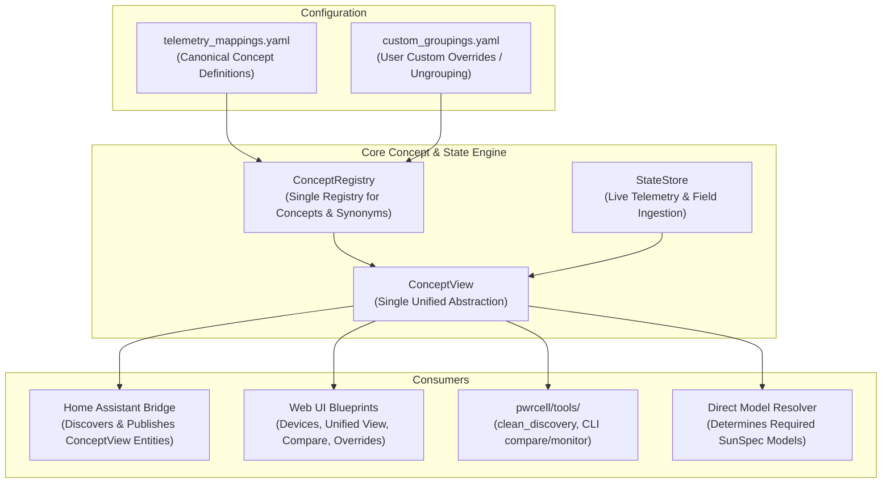

# Architectural Design: Unifying Grouping, Concept, and Comparison Abstractions (Step 6.8)

> [!NOTE]
> **No Backwards Compatibility Required**: Because the integration is in early development, all legacy dual-naming shims, alias bridges, and redundant data structures are eliminated rather than preserved.

---

## 1. Executive Summary & Problem Context

Currently, the codebase maintains **three separate, overlapping systems (~4,500 LOC total)** attempting to solve the same problem: associating raw MQTT push telemetry and SunSpec Modbus registers with a logical metric concept:

1. **`CompoundFieldView` & `MappingRegistry`** (`mapping.py`, `state.py`):
   - Created solely from `telemetry_mappings.yaml` (11 hardcoded concepts).
   - Generates `<device_type>.compound.<id>` entities with separate `mqtt_value` and `modbus_value`.
   - Hooks into `StateStore.set_field` notifications for Home Assistant publishing.
2. **`UnifiedFieldGroup` & `CANONICAL_SYNONYMS`** (`optimizer.py`, `grouping.py`):
   - Generates `<device_type>.concept.<id>` groups for every register on a device.
   - Contains a hardcoded ~270-line Python dictionary (`CANONICAL_SYNONYMS`) plus heuristic matching.
   - Powers the Web UI "Unified" view and feeds a 350-line weighted set-cover solver.
3. **`ComparisonResultRow` & `correlator.py` & `recommender.py`**:
   - Re-implements comparison, deltas, and discrepancies in a separate class (`ComparisonResultRow`).
   - Maintains a third synonym table (`SEMANTIC_SYNONYM_CLUSTERS`).
   - Intertwines API comparison endpoints with ANSI terminal formatting and live monitor loops.

By dropping backwards compatibility constraints, we can **delete the redundant abstractions entirely** and establish a single, unified, end-to-end model.

---

## 2. Target Architecture



---

## 3. Simplified Design Specifications

### 3.1. Single Unified Model: `ConceptView` (Replaces 3 Redundant Classes)

Delete `CompoundFieldView`, `UnifiedFieldGroup`, and `ComparisonResultRow`. Replace all three with a single dataclass: **`ConceptView`**.

```python
@dataclass
class ConceptSource:
    """A contributing telemetry source (MQTT push or Modbus register)."""
    source_type: str        # 'MQTT' or 'MODBUS'
    source_id: str          # 'MQTT', 'M102', 'M64208', etc.
    field_key: str          # e.g. 'inverter.model_64208.CTPow' or 'inverter.live.grid_power_w'
    name: str               # e.g. 'CTPow'
    label: str              # e.g. 'Grid Net Power (M64208)'
    model_id: Optional[int] = None
    value: Any = None
    raw_value: Any = None
    units: Optional[str] = None
    is_writable: bool = False
    transform: Optional[str] = None
    is_optimal: bool = True
    is_pinned: bool = False
    is_divergent: bool = False

@dataclass
class ConceptView:
    """Single unified representation of a logical metric across 1..N sources."""
    id: str                 # Canonical ID: '<device_type>.concept.<concept_key>'
    concept_key: str        # e.g. 'grid_power', 'battery_soc'
    device_sn: str
    device_type: str
    label: str
    description: str
    units: Optional[str] = None

    # Telemetry sources:
    sources: List[ConceptSource] = field(default_factory=list)
    active_source_key: Optional[str] = None
    latest_value: Any = None
    latest_source: str = "NONE"
    latest_updated: float = 0.0

    # Comparison / Discrepancy analysis:
    delta: Optional[float] = None
    match_pct: Optional[float] = None
    status: str = "SINGLE_SOURCE"   # 'EXACT', 'CLOSE', 'DIVERGENT', 'SINGLE_SOURCE', 'NO_DATA'
    is_discrepant: bool = False
    discrepancy_reason: str = ""

    # Home Assistant & Control properties:
    ha_platform: str = "sensor"     # 'sensor', 'select', 'number', 'binary_sensor'
    ha_device_class: Optional[str] = None
    ha_state_class: Optional[str] = None
    ha_options: Optional[List[str]] = None
    ha_suggested_display_precision: Optional[int] = None
    is_writable: bool = False
    is_custom_override: bool = False
    is_scale_factor: bool = False
```

#### Why this simplifies everything:
- **HA Bridge**: Publishes `ConceptView` instances directly under `f"{dev_sn}:{c.concept_key}"` or `c.id`. No compound-vs-raw split branching in `generate_discovery_payload`.
- **Web UI**: `/api/devices/<sn>` returns `concepts: [c.to_dict() for c in ...]` for both unified and comparison views.
- **Compare Tab**: Uses the exact same `ConceptView` list. When a concept has >1 sources, `delta`, `match_pct`, and `status` are already calculated natively.
- **Controls**: `write_field` writes directly to the writable source in `concept.sources`.

### 3.2. Single Concept & Synonym Registry (`ConceptRegistry`)

Delete the ~270-line `CANONICAL_SYNONYMS` dictionary in `optimizer.py` and the `SEMANTIC_SYNONYM_CLUSTERS` in `recommender.py`.

Consolidate all concept definitions into `telemetry_mappings.yaml` (managed by `ConceptRegistry`):
```yaml
concepts:
  - id: grid_power
    label: "Grid Net Power"
    device_type: inverter
    unit: W
    ha_device_class: power
    ha_state_class: measurement
    mqtt_field: "inverter.live.grid_power_w"
    modbus_primary: "inverter.model_64208.CTPow"
    modbus_candidates:
      - "inverter.model_64208.CTPow"
    synonyms: ["ctpow", "grid_power_w", "grid_power"]
    transform: negate
    transform_desc: "CT polarity inverted: positive = import"
    description: "Net power imported (+) or exported (-) to the utility grid"

  - id: system_mode
    label: "System Operating Mode"
    device_type: inverter
    ha_platform: select
    mqtt_field: "inverter.live.system_mode"
    modbus_primary: "rebus_beacon.model_64200.SysMd"
    synonyms: ["sysmd", "system_mode", "operating_mode"]
    description: "PWRcell operating mode"
```

- When grouping fields on a device, `ConceptRegistry.find_concept(dev_type, point_name, unit)` checks:
  1. `custom_groupings.yaml` overrides first.
  2. Concept definition in registry (matching `synonyms` or configured fields).
  3. Auto-concept fallback: grouping same-named points across models (e.g. `w`, `hz`).

### 3.3. Delete Weighted Set-Cover → Direct Model Resolution

Delete the 350-line combinatorial weighted set-cover algorithm in `optimizer.py`.

Replace with a direct model resolver:
1. Collect the set of active `(device_sn, model_id)` required by the selected concepts or points:
   ```python
   def resolve_required_models(concepts: List[ConceptView]) -> Set[int]:
       """Return the minimal set of SunSpec model IDs needed for selected concepts."""
       needed_models: Set[int] = set()
       for c in concepts:
           if not c.is_selected:
               continue
           # If active source is MQTT, no SunSpec model needed for this concept
           active = next((s for s in c.sources if s.field_key == c.active_source_key), None)
           if active and active.source_type == "MQTT":
               continue
           # If active source is a SunSpec model, add that model
           if active and active.model_id:
               needed_models.add(active.model_id)
           elif c.sources:
               # Pick primary or first SunSpec candidate
               mb_src = next((s for s in c.sources if s.model_id is not None), None)
               if mb_src:
                   needed_models.add(mb_src.model_id)
       return needed_models
   ```
2. This eliminates:
   - `_compute_model_weights`
   - `_score_candidate`
   - `_calculate_penalty`
   - `itertools.combinations` exhaustive cover solvers
   - Redundant state matrices

### 3.4. Relocate CLI & Diagnostic Tools into `pwrcell/tools/`

Organize diagnostic and offline tooling cleanly:
- `pwrcell/tools/clean_discovery.py`: Discovery purging CLI command.
- `pwrcell/tools/correlator.py`: Terminal table formatter and live CLI monitor.
- `pwrcell/tools/recommender.py`: Grouping recommendation heuristics.
- `cli.py`: Updated to import directly from `pwrcell.tools`.

---

## 4. Code Reductions & Impact

| Component | Before | After | Net Change |
|---|---|---|---|
| `state.py` (compound views & deduplication) | ~400 lines | ~80 lines | **-320 lines** |
| `optimizer.py` (synonyms & set-cover) | 1,274 lines | ~350 lines | **-920 lines** |
| `correlator.py` (duplicate comparisons) | 911 lines | ~250 lines (in `tools/`) | **-660 lines** |
| `mapping.py` / `ConceptRegistry` | 474 lines | ~250 lines | **-220 lines** |
| **Total Code Reduction** | **~3,059 lines** | **~930 lines** | **~ -2,100 lines (-68%)** |

---

## 5. Execution Steps

1. **Step 1: Golden Baseline Tests**:
   - Write golden snapshot tests for device concept grouping, comparison evaluation, and model resolution.
2. **Step 2: Implement `ConceptRegistry` & `ConceptView`**:
   - Unify `CompoundFieldView` and `UnifiedFieldGroup` into `ConceptView`.
   - Update `MappingRegistry` into `ConceptRegistry` with consolidated synonyms.
3. **Step 3: Direct Model Selector**:
   - Replace weighted set-cover with direct model resolver.
4. **Step 4: Relocate Tools to `pwrcell/tools/`**:
   - Move `clean_discovery.py`, terminal monitor, and `recommender.py` to `pwrcell/tools/`.
   - Update `cli.py` and UI routes.
5. **Step 5: Verify & Validate**:
   - Run unittest suite across all tests.
   - Stop for user verification prior to merging `review/phase-6b-unify-grouping`.
