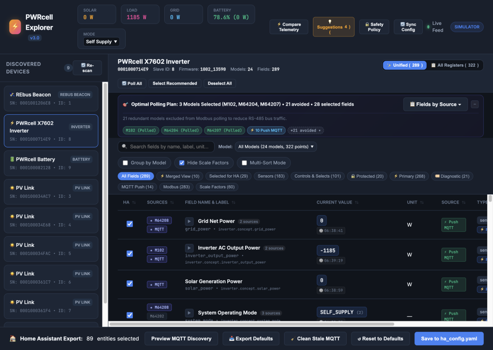
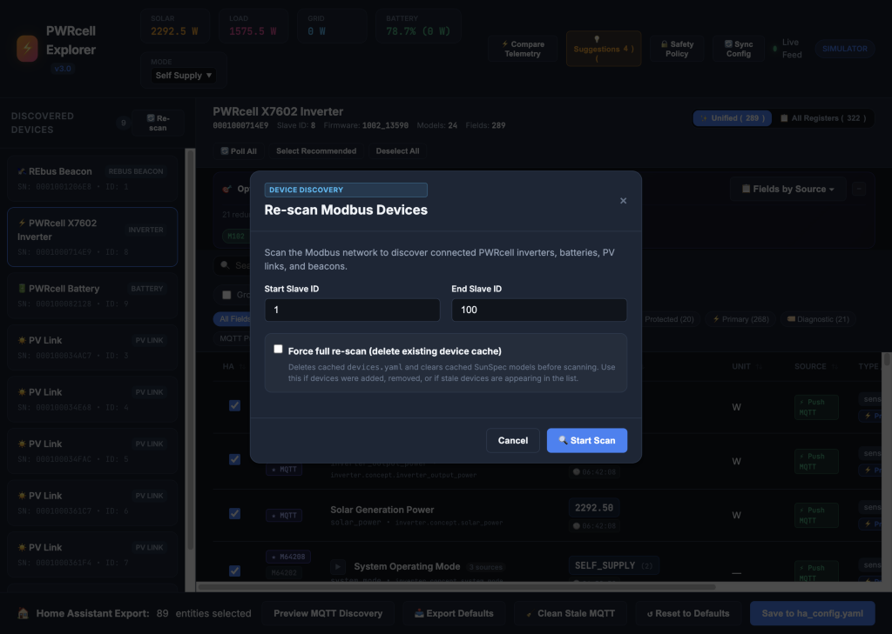
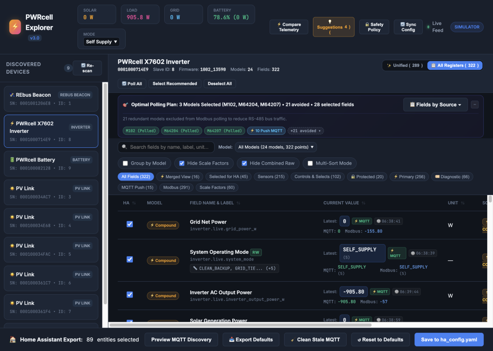
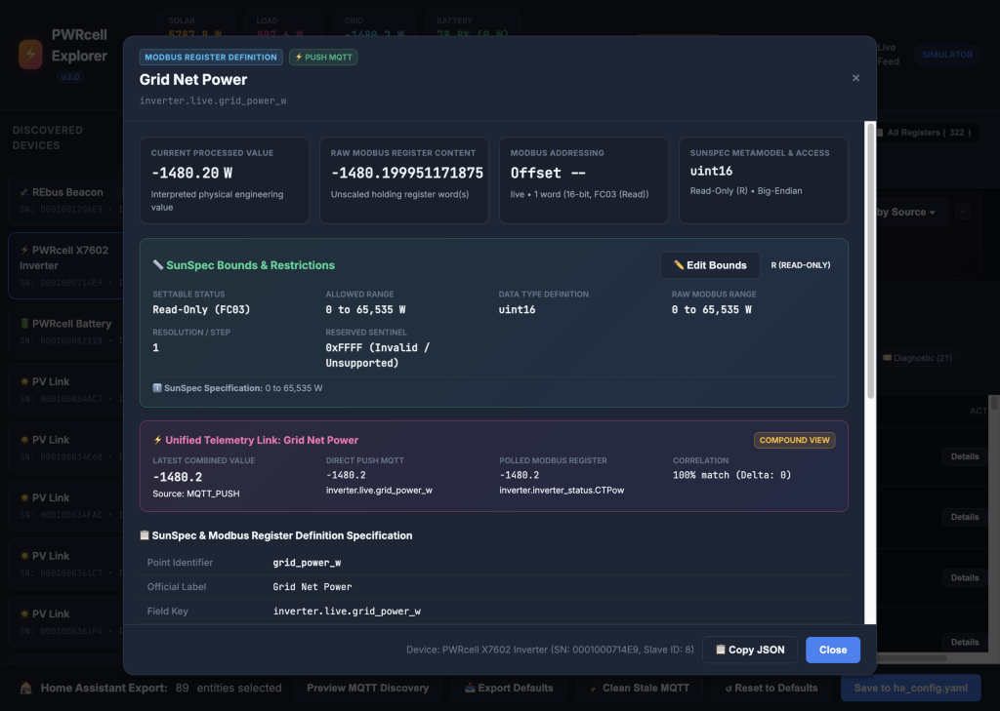
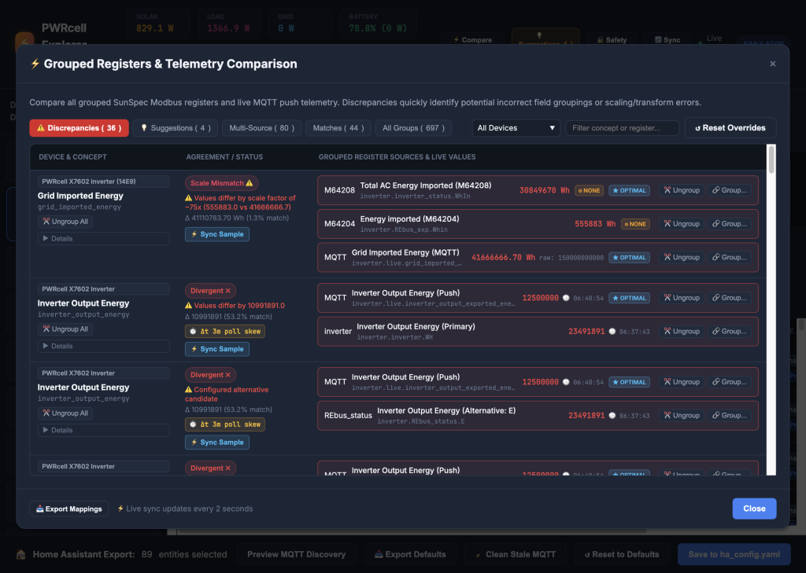
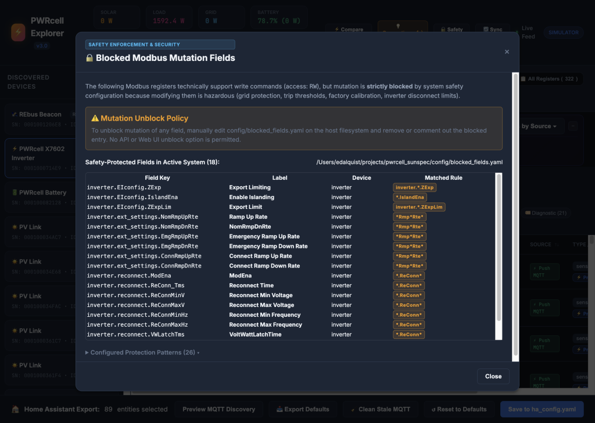
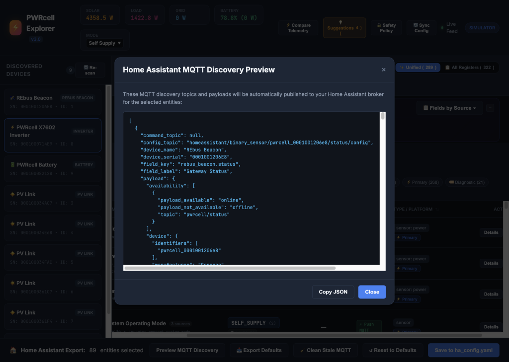
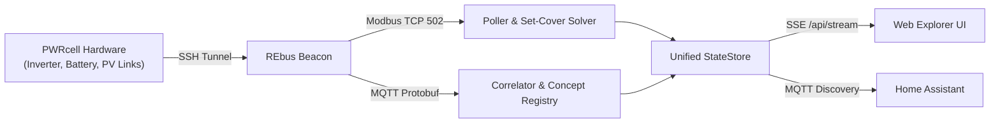

# PWRcell Management UI (Web Explorer) — Technical Guide

The **PWRcell Web Explorer** is the real-time diagnostic and configuration interface for Generac PWRcell systems. It normalizes proprietary Generac REbus MQTT push telemetry and SunSpec Modbus TCP register polling into a unified management grid.

Access the interface in your browser at `http://<host>:5555` or via the **Home Assistant sidebar** (Ingress). Telemetry streams reactively via Server-Sent Events (SSE) without page reloads.

---

## 1. UI Layout Overview

The interface is structured into five functional areas:
1. **Top Header**: Live site power summary, operational mode controls, and global diagnostics.
2. **Left Sidebar**: Tree of discovered hardware devices and network re-scanning.
3. **Device Banner & Polling Plan**: Device metadata, view mode switcher, and polling set-cover optimization.
4. **Toolbar & Field Grid**: Search, model filters, and the telemetry register table.
5. **Footer Drawer**: Home Assistant MQTT discovery staging, preview, and topic cleanup.

---

## 2. Top Header & System Dashboard

### Real-Time Power Chips
Computed dynamically from active compound telemetry views:
- **Solar**: Instantaneous DC/AC generation from all PV strings ($W$).
- **Load**: Total household electrical power consumption ($W$), calculated as $P_{\text{load}} = P_{\text{solar}} + P_{\text{grid}} + P_{\text{battery}}$.
- **Grid**: Net utility grid exchange ($W$). Negative = export to grid; positive = import from grid.
- **Battery**: State of charge percentage ($0\text{--}100\%$) and active charge/discharge rate ($W$). Negative = discharging; positive = charging.

### System Operating Mode Selector
Writing to this dropdown issues an immediate Modbus command to `rebus_beacon.REbus_dir.SysMd` with enum verification:

| Mode | System Behavior |
| :--- | :--- |
| `SELF_SUPPLY` | Charges battery from surplus solar; discharges to cover home loads before exporting. |
| `CLEAN_BACKUP` | Holds battery at $100\%$ SoC for grid outages. Everyday loads do not cycle the battery. |
| `PRIORITY_BACKUP` | Charges battery to $100\%$ immediately from both solar and grid power. |
| `GRID_CONNECT` | Standard grid-tied PV operation; battery remains in standby. |
| `SAFETY_SHUTDOWN` | Opens AC contactor and initiates safe shutdown of DC bus and battery contactors. |
| `ARBITRAGE` | Scheduled time-of-use (TOU) battery cycling against utility tariff windows. |
| `FULL_EXPORT` | Discharges battery and exports maximum solar to the utility for demand programs. |

### Header Action Buttons
- **⚡ Compare Telemetry**: Opens the Modbus vs. MQTT push correlation analysis modal.
- **💡 Suggestions**: Surfaces candidate register pairings detected by the correlation engine.
- **🔒 Safety Policy**: Displays Modbus registers locked by system safety rules to prevent hazardous writes.
- **🔄 Sync Config**: Triggers an on-demand Modbus read of keypad setpoints without waiting for the background polling cycle.
- **Live Indicator**: Green pulsing dot indicates active SSE connection (`/api/stream`). Auto-reconnects if interrupted.
- **Mode Tag**: Indicates whether connected to live hardware via SSH tunnel or running the mock simulator (`--mock`).

---

## 3. Device Tree & Discovery (Left Sidebar)

### Device List
Select a device from the sidebar to inspect its registers:
- **REbus Beacon (Slave 1)**: System gateway and communications bridge.
- **PWRcell Inverter (Slave 8)**: Single/split-phase bi-directional inverter.
- **PWRcell Battery (Slave 9)**: Lithium-ion storage cabinet.
- **PV Links (Slaves 10+)**: DC-DC solar optimizers and string disconnects.
- **ICM**: Automatic transfer switch and load management module.

### Re-scan Modbus Network
Click **🔄 Re-scan** in the sidebar header to discover connected hardware:

- **Start / End Slave ID**: Modbus address probe range (default: `1` to `100`, max `247`).
- **Force full re-scan**: Deletes `/data/devices.yaml` and clears cached SunSpec models on disk before scanning. Use when adding/replacing hardware or clearing stale devices.

---

## 4. Device Banner & Polling Optimization

### Device Metadata & Batch Controls
- **Metadata**: Hardware serial number, Modbus slave ID, firmware revision, supported SunSpec models, and field counts.
- **🔄 Poll All**: Synchronously polls every SunSpec model supported by this device.
- **Select Recommended**: One-click selection of standard energy monitoring entities for Home Assistant.
- **Deselect All**: Clears all entity export selections for this device.
- **📋 Apply to All**: Copies the current device's entity export selections to all peer devices of the same type (e.g. across multiple PV Links).

### View Modes
- **Unified Semantic View (✨ Default)**: Merges redundant multi-protocol inputs (e.g. Model 701 `CTPow`, Model 64208, and MQTT push) into single canonical concept rows (e.g., `inverter.concept.grid_power`). Automatically selects the optimal source.
- **All Registers View (📋 Raw)**: Shows every raw SunSpec register point, scale factor exponent (`*_SF`), and raw MQTT push field individually for low-level protocol debugging.

### Minimal Model Polling Plan
The built-in **Weighted Set-Cover Solver** minimizes Modbus bus traffic by polling only the SunSpec models necessary to cover all selected fields:
- **Polled Models**: Models actively queried during fast polling (e.g., `M701`, `M702`).
- **Models Avoided**: Models bypassed entirely (e.g., `M102`, `M160`, `M64208`), conserving bus bandwidth.
- **📋 Fields by Source ▾**: Expands a detailed breakdown of which fields are fulfilled by each model or protocol.
- **Source Pinning**: Click any source badge in the data table to force a field to a specific source. The solver recalculates around your pin.
- **↺ Reset to Auto**: Reverts manual pins to the mathematical optimum.

---

## 5. Toolbar: Search, Filters & Display Options

- **Search Box**: Multi-term fuzzy filtering by field name, register key (`CTPow`), display label, unit, or description.
- **Model Dropdown**: Restricts the grid to a specific SunSpec model (e.g. `Model 701: DER AC Measurement`).
- **Group by Model**: Sections table rows under collapsible model headers.
- **Hide Scale Factors**: Suppresses raw `*_SF` exponent registers since displayed values are already scaled.
- **Hide Combined Raw**: In Unified view, hides raw inputs covered by an active merged concept.
- **Multi-Sort Mode**: Enables multi-column table sorting without holding `Shift`.
- **Filter Pills**: Instant one-click filters:
  - `All Fields`, `⚡ Merged View`, `Selected for HA`, `Sensors`, `Controls & Selects`
  - `🔒 Protected`, `⚡ Primary`, `🏷️ Diagnostic`, `MQTT Push`, `Modbus`, `Scale Factors`

---

## 6. Field Data Table & Row Actions

### Columns
- **HA**: Export checkbox for Home Assistant MQTT discovery.
- **Sources**: Badges showing candidate sources. Green outline = active optimal source; solid fill = pinned source.
- **Field Name & Label**: Canonical label and monospace internal register key.
- **Current Value**: Live updating value. Flashes green (increase), amber (decrease), or blue (state/enum change).
- **Unit**: Engineering unit ($W$, $V$, $A$, $Hz$, $\%$, $^{\circ}C$, $kWh$).
- **Source**: Current data source (`MQTT` or `Modbus M<id>`).
- **Type / Platform**: Entity category dropdown (`Primary`, `Diagnostic`, `System`, `Disabled`) and HA platform (`sensor`, `number`, `select`).
- **Actions**: Contextual action buttons.

---

### Row Action Modals

#### 1. Modbus Register Details Inspector (🔍)
Displays complete low-level wire definitions for SunSpec registers:

- SunSpec Model ID, 16-bit register offset, and absolute Modbus address.
- Wire datatype (`uint16`, `int16`, `acc32`, `string`) and access level (`R` / `RW`).
- Scale factor register mapping and current power-of-10 exponent.
- Raw unscaled value vs. computed engineering value.
- Complete SunSpec enum symbol dictionary and event/alarm bitfield definitions.

#### 2. Write Value Modal (✏️)
- For writable setpoints: input target numeric values within validated min/max boundaries.
- For writable enums: choose from validated SunSpec dropdown options.
- Executes Modbus function code 6 or 16 with immediate read-back verification.

#### 3. Field Grouping Modal (🔗)
- Merge a field into an existing concept on this device.
- Create a new custom concept identifier and label.
- Ungroup/isolate a field to manage it as an independent standalone entity.
- Value transform: `Direct (No Transform)` or `Invert / Negate (× -1)` for opposite sign conventions.

#### 4. Physical Field Bounds Modal (📏)
- Set custom minimum, maximum, and slider resolution step increments.
- Invalid writes outside bounds are rejected by the proxy.
- Toggle **Apply across all devices of this type** to replicate limits across peer hardware (e.g. all batteries).

---

## 7. Telemetry Comparison Tool (`⚡ Compare Telemetry`)

Compares live polled Modbus registers directly against MQTT push messages to identify mapping errors, scaling issues, or sign conflicts.

### Filter Tabs
- **⚠️ Discrepancies**: Concepts where Modbus and MQTT streams diverge.
- **💡 Suggestions**: Unmapped pairings detected by the correlation engine.
- **Multi-Source**: All concepts backed by two or more active streams.
- **Matches**: Fields with verified cross-protocol agreement.
- **All Groups**: Complete inventory of all grouped concepts.

### Agreement Classifications

| Status Badge | Meaning | Typical Root Cause |
| :--- | :--- | :--- |
| `EXACT` | Values match within strict numerical tolerance ($< 1\%$). | Verified agreement. |
| `CLOSE` | Minor delta ($1\text{--}5\%$). | Polling latency during fast load transitions. |
| `POLARITY_MISMATCH` | Equal magnitude, opposite sign ($+X$ vs $-X$). | Inverter perspective vs. utility meter perspective. |
| `SCALE_MISMATCH` | Differ by an exact multiple of 10 or 1000. | Scale factor register error or unit mismatch. |
| `UNIT_MISMATCH` | Incompatible engineering units ($W$ vs $V$). | Incorrect register assigned to group. |
| `DIVERGENT` | Values differ by $> 10\%$ with no mathematical pattern. | Telemetry mismatch or wrong register mapping. |

### Comparison Tools
- **Sync Sample**: Synchronously queries Modbus and latches the next MQTT packet within $50\text{ ms}$ to eliminate polling skew.
- **Fix Polarity**: Resolves sign mismatches by selecting **+ Positive Convention**, **- Negative Convention**, or **Keep Raw**.
- **Suggestions Engine**: Recommends high-covariance register pairings ($\ge 85\%$ or $\ge 65\%$ confidence) with one-click approval or dismissal.
- **Unmapped Protobuf Detector**: Lists undocumented MQTT tags and wire channels observed on the bus for reverse engineering.

---

## 8. Safety Policy & Protected Registers (`🔒 Safety Policy`)

SunSpec specifies certain registers as read/write (`RW`) that are hazardous to modify on active grid-tied systems.

Protected parameters include:
- Anti-islanding disconnect thresholds (`inverter.EIconfig.IslandEna`).
- Grid trip voltage and frequency limits (`V_Trip_Max`, `Hz_Trip_Min`).
- Factory battery capacity calibration and cell balancing constants.

> [!CAUTION]
> Protected registers **cannot be unlocked via the Web UI or REST API**. To unlock mutation for a field, an administrator must manually edit `config/blocked_fields.yaml` on the host filesystem.

---

## 9. Home Assistant Discovery & Export Drawer (Footer)

The persistent bottom drawer controls MQTT Discovery publishing to Home Assistant:

- **Preview MQTT Discovery**: Inspects live JSON discovery payloads and topic structures before publishing:

- **Save to ha_config.yaml**: Persists staged entities to `/data/ha_config.yaml`. The MQTT bridge dynamically reloads and publishes discovery without restarting the add-on.
- **Reset to Defaults**: Restores the recommended baseline from `config/ha_default_config.yaml` and clears custom overrides.
- **Clean Stale MQTT**: Sweeps the broker for orphaned `homeassistant/+/pwrcell_*` discovery topics and purges deleted entities from Home Assistant.
- **Export Defaults / Mappings**: Generates sanitized YAML files (`ha_default_config.yaml` or `groupings.yaml`) to contribute improvements back to the upstream repository.

---

## 10. Architecture Summary

1. **Dual Ingestion**: High-frequency proprietary MQTT push streams combined with typed SunSpec Modbus TCP register polling.
2. **Unified StateStore**: Coordinates scale conversions, enum translations, and concept grouping.
3. **Reactive UI**: Real-time browser updates driven entirely via Server-Sent Events (SSE).
