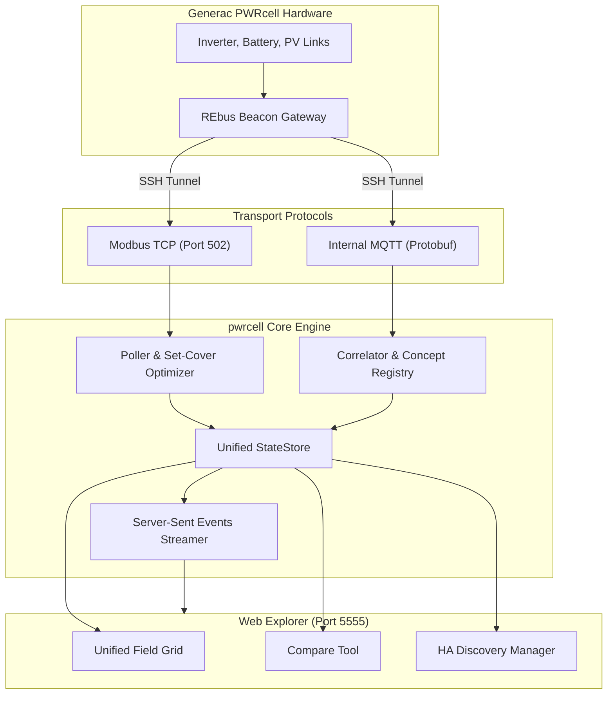

# PWRcell Management UI (Web Explorer) — Technical User Guide

The **PWRcell Web Explorer** is the diagnostic and management dashboard for the Generac PWRcell energy storage system. It allows technical users to inspect live telemetry, drill into raw SunSpec Modbus registers and MQTT push streams, tune polling efficiency, calibrate sensor groupings, and control which entities publish to Home Assistant.

This document is a comprehensive functional reference covering every screen, control, modal, and workflow in the interface.

---

## Table of Contents

1. [UI Layout & Navigation Map](#1-ui-layout--navigation-map)
2. [Top Header & System Dashboard](#2-top-header--system-dashboard)
   - [Real-Time Power Chips](#real-time-power-chips)
   - [System Operating Mode Selector](#system-operating-mode-selector)
   - [Header Action Buttons](#header-action-buttons)
3. [Device Tree & Hardware Discovery (Left Sidebar)](#3-device-tree--hardware-discovery-left-sidebar)
   - [Device List & Selection](#device-list--selection)
   - [Re-scan Modbus Network Modal](#re-scan-modbus-network-modal)
4. [Device Banner & Polling Plan](#4-device-banner--polling-plan)
   - [Device Metadata & Quick Actions](#device-metadata--quick-actions)
   - [View Mode: Unified Semantic vs. All Registers](#view-mode-unified-semantic-vs-all-registers)
   - [Minimal Model Polling Plan Banner](#minimal-model-polling-plan-banner)
5. [Search, Filtering & View Toggles (Toolbar)](#5-search-filtering--view-toggles-toolbar)
   - [Search Box & Model Filter](#search-box--model-filter)
   - [View Option Toggles](#view-option-toggles)
   - [Filter Pills Catalog](#filter-pills-catalog)
6. [Field Data Table & Row Actions](#6-field-data-table--row-actions)
   - [Table Columns Explained](#table-columns-explained)
   - [Entity Category Dropdown](#entity-category-dropdown)
   - [Action: Modbus Register Details Inspector (🔍)](#action-modbus-register-details-inspector-)
   - [Action: Write Value Modal (✏️)](#action-write-value-modal-️)
   - [Action: Field Grouping & Regrouping Modal (🔗)](#action-field-grouping--regrouping-modal-)
   - [Action: Physical Field Bounds Modal (📏)](#action-physical-field-bounds-modal-)
7. [Telemetry Comparison & Discrepancy Tool (`⚡ Compare Telemetry`)](#7-telemetry-comparison--discrepancy-tool--compare-telemetry)
   - [Filter Tabs & Navigation](#filter-tabs--navigation)
   - [Agreement Classifications](#agreement-classifications)
   - [Synchronized Sample Reading (`Sync Sample`)](#synchronized-sample-reading-sync-sample)
   - [Polarity Convention Selector (`Fix Polarity`)](#polarity-convention-selector-fix-polarity)
   - [Grouping Suggestions Engine](#grouping-suggestions-engine)
   - [Unmapped MQTT Protobuf Wire Detector](#unmapped-mqtt-protobuf-wire-detector)
8. [Safety Enforcement Modal (`🔒 Safety Policy`)](#8-safety-enforcement-modal--safety-policy)
9. [Home Assistant Discovery & Export Drawer (Footer)](#9-home-assistant-discovery--export-drawer-footer)
   - [Preview MQTT Discovery Modal](#preview-mqtt-discovery-modal)
   - [Configuration Persistence & Reset Actions](#configuration-persistence--reset-actions)
   - [Clean Stale MQTT Discovery Topics](#clean-stale-mqtt-discovery-topics)
   - [Exporting Defaults & Upstream Mappings](#exporting-defaults--upstream-mappings)
10. [Underlying Architecture Overview](#10-underlying-architecture-overview)

---

## 1. UI Layout & Navigation Map

```
+---------------------------------------------------------------------------------------------------------+
| [2. HEADER]  Solar: 4.2kW | Load: 1.8kW | Grid: -2.4kW | Bat: 88% | Mode: [SELF_SUPPLY ▾]               |
|              [⚡ Compare Telemetry] [💡 Suggestions] [🔒 Safety Policy] [🔄 Sync Config] (• Live Feed)   |
+------------------------------+--------------------------------------------------------------------------+
| [3. SIDEBAR]                 | [4. DEVICE BANNER] Inverter SN: 0001000714E9 | Slave: 8 | Firmware: 2080  |
| Discovered Devices           | Mode: [✨ Unified (42)] [📋 All Registers (184)]                          |
| [🔄 Re-scan]                 | Actions: [🔄 Poll All] [Select Recommended] [Deselect All] [Apply to All] |
|                              +--------------------------------------------------------------------------+
| • REbus Beacon (Slave 1)     | 🎯 Minimal Model Polling Plan [Polled: 701, 702] [Avoided: 102, 160]     |
| > Inverter (Slave 8)         | [📋 Fields by Source ▾] [↺ Reset to Auto]                                |
| • Battery (Slave 9)          +--------------------------------------------------------------------------+
| • PV Link 1 (Slave 10)       | [5. TOOLBAR] 🔍 [Search...] [Model: All ▾] [x] Group by Model            |
| • PV Link 2 (Slave 11)       | Pills: [All] [Merged] [Selected HA] [Sensors] [Controls] [Protected]     |
|                              +--------------------------------------------------------------------------+
|                              | [6. DATA TABLE]                                                          |
|                              | HA | Sources | Field Name & Key    | Value   | Unit | Source | Actions    |
|                              |----+---------+---------------------+---------+------+--------+------------|
|                              | [x]| M701,MQTT| Grid Power (W)      | -2400.0 | W    | MQTT   | 🔍 🔗 📏    |
|                              | [x]| M702    | Max Reserve SoC     | 30.0    | %    | Modbus | 🔍 ✏️ 📏    |
+------------------------------+--------------------------------------------------------------------------+
| [9. FOOTER] 🏠 HA Export: 24 entities | [Preview MQTT] [Clean Stale MQTT] [Reset] [Save to ha_config]   |
+---------------------------------------------------------------------------------------------------------+
```

The interface is accessible directly in your web browser at `http://<host>:5555` or through the **Home Assistant sidebar** via Ingress. All real-time telemetry updates continuously using **Server-Sent Events (SSE)** without requiring browser page refreshes.

---

## 2. Top Header & System Dashboard

The persistent top header displays high-level system state, real-time power metrics, and global operational tools.

### Real-Time Power Chips
These dynamic badges display site-wide electrical power calculated from active compound telemetry views:
- **Solar**: Total instantaneous power generated by all PV strings ($W$).
- **Load**: Total household electrical power consumption ($W$), dynamically computed as $P_{\text{load}} = P_{\text{solar}} + P_{\text{grid}} + P_{\text{battery}}$.
- **Grid**: Net utility grid power exchange ($W$). Negative indicates power exported to the grid; positive indicates power imported from the grid.
- **Battery**: State of charge percentage ($0\text{--}100\%$) and active charge/discharge rate in Watts ($W$). Negative wattage indicates discharging into home loads or grid; positive wattage indicates charging.

### System Operating Mode Selector
An interactive dropdown in the header allows changing the active operating mode of the PWRcell inverter and REbus beacon:
- `SELF_SUPPLY`: Charges the battery from surplus solar production during the day and discharges the battery to cover home loads during the evening. Minimizes grid import.
- `CLEAN_BACKUP`: Reserves $100\%$ battery capacity exclusively for grid outages. Solar powers the home or exports surplus to the grid; the battery is never discharged during normal grid-tied operation.
- `PRIORITY_BACKUP`: Outage preparation mode. Charges the battery to $100\%$ as quickly as possible from both solar and utility grid power.
- `GRID_CONNECT` (Grid Tie): Operates strictly as a traditional grid-tied PV inverter. The battery remains in idle standby.
- `SAFETY_SHUTDOWN`: Opens the main AC contactor and initiates safe disconnect of all DC bus and battery contactors.
- `ARBITRAGE`: Enables time-of-use (TOU) scheduled battery cycling to charge at off-peak rates and discharge during peak utility pricing.
- `FULL_EXPORT`: Aggressively discharges the battery and exports all solar energy to the grid for demand-response or wholesale export programs.

> [!IMPORTANT]
> Selecting a mode immediately triggers an authenticated Modbus write to register `rebus_beacon.REbus_dir.SysMd` (or inverter equivalent), validates the integer code against SunSpec specifications, and awaits confirmation before updating the UI state.

### Header Action Buttons
- **⚡ Compare Telemetry**: Opens the telemetry correlation tool to cross-reference live Modbus register reads against MQTT push messages.
- **💡 Suggestions**: Appears when the correlation engine identifies unmapped Modbus registers that correlate strongly with push telemetry.
- **🔒 Safety Policy**: Opens a registry of hazardous Modbus registers that are protected from accidental writes.
- **🔄 Sync Config**: Triggers an immediate, on-demand Modbus read of all front-panel keypad settings, configuration registers, and setpoints without waiting for background polling cycles.
- **Live Feed Indicator**: A green pulsing dot indicating an active SSE connection (`/api/stream`). If network connectivity is interrupted, the badge indicates reconnection status with automatic backoff.
- **Simulator / Hardware Tag**: Indicates whether the backend is communicating with real hardware over an SSH tunnel or running the built-in mock simulator (`--mock`).

---

## 3. Device Tree & Hardware Discovery (Left Sidebar)

The left sidebar lists all hardware components discovered on the PWRcell REbus / Modbus communication loop.

### Device List & Selection
Clicking any device in the list focuses the main data table and banner on that hardware unit:
- **REbus Beacon (Slave 1)**: System controller, master gateway, and internet bridge (`rebus_beacon`).
- **PWRcell Inverter (Slave 8)**: Single-phase or split-phase bi-directional inverter (`inverter`).
- **PWRcell Battery (Slave 9)**: Modular lithium-ion battery cabinet (`battery`).
- **PV Links (Slaves 10+)**: High-voltage DC-DC solar optimizers and string disconnects (`pv_link`).
- **ICM**: Interconnection and transfer switch management module (`icm`).

Each entry in the list displays its model name, assigned slave ID, serial number, and an active field count badge.

### Re-scan Modbus Network Modal
Click the **🔄 Re-scan** button at the top of the sidebar to initiate hardware discovery:
- **Start Slave ID / End Slave ID**: Defines the Modbus slave address scanning range (default: `1` to `100`, expandable up to `247`).
- **Force full re-scan (delete existing device cache)**: When checked, deletes `/data/devices.yaml` and clears cached SunSpec models on disk before scanning. Use this if you have added new PV Links, replaced an inverter board, or need to purge decommissioned devices from the list.
- **Start Scan**: Executes the scan sequentially over Modbus TCP. Discovered devices populate the sidebar immediately.

---

## 4. Device Banner & Polling Plan

When a device is selected, the banner across the top of the main workspace displays device diagnostics and configuration controls.

### Device Metadata & Quick Actions
- **Metadata Summary**: Shows the hardware serial number, Modbus slave ID, firmware revision, supported SunSpec model count, and total register count.
- **🔄 Poll All**: Forces an immediate, synchronous read of *every* SunSpec model supported by this device. Use this if fields appear blank or uninitialized.
- **Select Recommended**: Automatically checks the recommended Home Assistant export entities for this device type (e.g., active power, energy meters, battery SoC, system mode).
- **Deselect All**: Clears all entity export selections for this device.
- **📋 Apply to All**: Appears on multi-device systems (e.g., systems with multiple PV Links or dual battery cabinets). Copies the exact entity selection schema from the current device to all peer devices of the same type.

---

### View Mode: Unified Semantic vs. All Registers

Toggle between views using the segmented control in the banner:

```
[ ✨ Unified (42) ]    [ 📋 All Registers (184) ]
```

#### 1. Unified Semantic View (✨ Default)
Generac hardware exposes the same physical metric across multiple protocols and models (e.g., grid power is available via SunSpec Model 701, Model 64208, and MQTT push telemetry).
- Combines redundant inputs into a single canonical concept row (e.g., `inverter.concept.grid_power`).
- Automatically resolves the optimal data source using the set-cover solver.
- Prevents exporting duplicate or competing entities to Home Assistant.

#### 2. All Registers View (📋 Raw)
- Displays every underlying SunSpec register, point, scale factor register (`*_SF`), and raw MQTT push field individually.
- Useful for low-level protocol debugging, verifying firmware offsets, or inspecting raw integer representations.

---

### Minimal Model Polling Plan Banner

Polling unnecessary Modbus registers over serial or REbus bridges increases latency. The Web Explorer integrates a **Weighted Set-Cover Solver** that identifies the smallest subset of SunSpec models required to satisfy all selected fields.

The banner displays:
- **Polled Models**: SunSpec models actively scheduled for routine fast polling (e.g., `M701`, `M702`).
- **Models Avoided**: SunSpec models completely skipped during polling cycles (e.g., `M102`, `M160`, `M64208`), conserving bus bandwidth.
- **📋 Fields by Source ▾**: Expands a detailed accordion listing which specific fields are satisfied by each model or protocol.
- **Source Pinning**: If you click a specific source badge (e.g., `M701` instead of `MQTT`) in the data table, that field is **pinned**. The solver recalculates the polling plan around your pinned requirement.
- **↺ Reset to Auto**: Reverts all manual source pins back to the solver's automatic mathematical optimum.

---

## 5. Search, Filtering & View Toggles (Toolbar)

The toolbar above the data grid provides real-time search, model isolation, and display options.

### Search Box & Model Filter
- **Search Input**: Instant multi-term fuzzy filter matching field names, register keys (e.g., `CTPow`), human-readable labels, physical units, or descriptions.
- **Clear Button (×)**: Resets the search query.
- **Model Dropdown**: Filters the table to a specific SunSpec model (e.g., `Model 1: Common`, `Model 701: DER AC Measurement`, `MQTT Push Telemetry`).

### View Option Toggles
- **Group by Model**: Groups table rows into collapsible visual sections by SunSpec model number.
- **Hide Scale Factors**: Hides raw scale factor exponent registers (e.g., `W_SF`, `A_SF`) since values in the table are already scaled.
- **Hide Combined Raw**: When in Unified View, hides raw underlying telemetry inputs that are already covered by an active merged concept.
- **Multi-Sort Mode**: Allows sorting by multiple table columns simultaneously without having to hold the `Shift` key.

### Filter Pills Catalog
Click any pill to instantly isolate specific subsets of data:
- **All Fields**: Disables all category filters.
- **⚡ Merged View**: Shows only fields composed of multiple redundant telemetry sources.
- **Selected for HA**: Isolates fields currently selected for Home Assistant MQTT export.
- **Sensors**: Read-only numerical or state sensors.
- **Controls & Selects**: Writable setpoints, operating modes, or configuration switches.
- **🔒 Protected**: Shows registers marked writable by SunSpec but locked by safety configuration.
- **⚡ Primary**: Entities configured for primary Home Assistant dashboard display.
- **🏷️ Diagnostic**: Entities categorized under Home Assistant Device Diagnostics.
- **MQTT Push**: Fields sourced from internal Protobuf push messages.
- **Modbus**: Fields polled from SunSpec TCP registers.
- **Scale Factors**: Raw `int16` exponent registers.

---

## 6. Field Data Table & Row Actions

The main table lists all telemetry points matching your active search and filter criteria.

```
| HA | Sources | Field Name & Label | Current Value | Unit | Source | Type / Platform | Actions |
```

### Table Columns Explained
1. **HA (Export Checkbox)**: Check to include this field in the Home Assistant configuration. Uncheck to exclude it.
2. **Sources**: Badges showing candidate data sources for this metric:
   - Green outline: The active optimal source selected by the solver.
   - Solid fill: A manually pinned source.
3. **Field Name & Label**: Canonical display label and internal technical key (in monospace font).
4. **Current Value**: Real-time value with live visual feedback:
   - Green flash: Value increased.
   - Amber flash: Value decreased.
   - Blue flash: State or enum change.
5. **Unit**: Engineering unit ($W$, $V$, $A$, $Hz$, $\%$, $^{\circ}C$, $kWh$).
6. **Source**: Protocol fulfilling the live value (`MQTT` or `Modbus M<id>`).
7. **Type / Platform**: Entity category and target Home Assistant entity platform (`sensor`, `number`, `select`).
8. **Actions**: Contextual action buttons for inspecting, writing, grouping, and bounding fields.

---

### Entity Category Dropdown
Located in the **Type / Platform** column, this dropdown configures how Home Assistant displays the entity:
- **Primary**: Standard entity; appears on the main device card and default dashboards.
- **Diagnostic**: Assigned to Home Assistant's `diagnostic` category; visible in device settings but kept off default overview dashboards.
- **System**: Internal system metric.
- **Disabled**: Registered in Home Assistant but disabled by default (`enabled_by_default: false`).

---

### Action: Modbus Register Details Inspector (🔍)
Click the **🔍 Inspect** button on any row to open the low-level **Modbus Register Definition Modal**:

- **Model & Register Offset**: Displays the SunSpec Model ID, 16-bit register offset, and absolute Modbus address.
- **Data Type & Access**: Reports wire encoding (e.g., `uint16`, `int16`, `int32`, `acc32`, `string`) and read/write permission (`R` or `RW`).
- **Scale Factor Mapping**: Identifies the associated scale factor point (e.g., `CTPow_SF`), its register address, and current power-of-10 multiplier.
- **Raw vs. Scaled Values**: Shows the raw integer/hex payload alongside the converted engineering value.
- **Enum Symbol Dictionary**: For enumeration registers, prints the complete table of integer codes and corresponding SunSpec symbol names.
- **Bitfield Definitions**: For alarm/event bitmasks (e.g., `Evt1`, `StBits`), lists each active bit and its associated diagnostic description.

---

### Action: Write Value Modal (✏️)
Click the **✏️ Edit** button on any writable control point to open the write dialog:
- **Numeric Values**: Displays current value, physical units, and allowed min/max boundaries. Enter a new value and click **Confirm Write**.
- **Enum Selects**: Displays a dropdown of valid SunSpec string options (e.g., operating modes or grid profile selections).
- **Execution**: The client executes a Modbus function code 6 or 16 write, followed by an immediate verification read-back.

---

### Action: Field Grouping & Regrouping Modal (🔗)
Click the **🔗 Group** button to customize how raw Modbus and MQTT telemetry fields merge:

- **Group with existing concept**: Merges this register with an existing logical group on this device.
- **Create custom concept**: Enter a new concept identifier and display label to establish a new unified metric.
- **Ungroup / Isolate**: Separates this field from any existing group, treating it strictly as an independent standalone entity.
- **Value Polarity / Transform**:
  - `Direct (No Transform)`: Preserves raw sign and values.
  - `Invert / Negate (× -1)`: Inverts the sign (useful for reconciling opposite sign conventions between grid meters and inverters).
- **Reset to Default**: Discards custom overrides for this field and reverts to built-in system groupings.
- **Save Grouping**: Persists changes to `/data/custom_groupings.yaml`.

---

### Action: Physical Field Bounds Modal (📏)
Click the **📏 Bounds** button to configure hardware boundaries:
- **Minimum / Maximum Allowed**: Sets physical safety limits. Any write request outside these limits will be rejected by the proxy.
- **Resolution Step**: Defines the slider step increment for Home Assistant `number` controls (e.g., `0.1` or `1.0`).
- **Apply across all devices of this type**: Applies the limits to all peer devices (e.g., applying battery reserve limits across all installed battery cabinets).

---

## 7. Telemetry Comparison & Discrepancy Tool (`⚡ Compare Telemetry`)

Click **⚡ Compare Telemetry** in the top header to open the correlation analysis workspace. This tool compares live SunSpec Modbus register reads directly against MQTT push messages to identify mapping errors, scaling issues, or sign conflicts.

```
+----------------------------------------------------------------------------------------------------+
| ⚡ Grouped Registers & Telemetry Comparison                                                        |
+----------------------------------------------------------------------------------------------------+
| Tabs: [ ⚠️ Discrepancies (2) ] [ 💡 Suggestions (3) ] [ Multi-Source (12) ] [ Matches (24) ]       |
| Filter: [ Device: All ▾ ] [ Search concept... ]                          [ ↺ Reset Overrides ]    |
+----------------------------------------------------------------------------------------------------+
| Device & Concept     | Status       | Grouped Sources & Values                     | Actions       |
|----------------------+--------------+----------------------------------------------+---------------|
| Inverter             | ⚠️ POLARITY  | • MQTT: 2450 W (grid_power_w)                | [Sync Sample] |
| Grid Power           | MISMATCH     | • Modbus M701: -2450 W (CTPow)               | [Fix Polarity]|
|                      |              |   Δ: -4900 W (-200.0%)                       |               |
+----------------------------------------------------------------------------------------------------+
```

### Filter Tabs & Navigation
- **⚠️ Discrepancies**: Filters strictly to fields where Modbus and MQTT streams diverge or disagree.
- **💡 Suggestions**: Surfaces candidate register pairings detected by the correlation engine.
- **Multi-Source**: Shows all concepts backed by two or more active telemetry streams.
- **Matches**: Displays fields where Modbus and MQTT values are in verified agreement.
- **All Groups**: Complete inventory of all grouped concepts across all devices.

---

### Agreement Classifications

Every multi-source row is evaluated against strict numerical criteria:

| Status Badge | Meaning | Typical Root Cause |
| :--- | :--- | :--- |
| `EXACT` | Values match within strict numerical tolerance ($< 1\%$). | Verified agreement across protocols. |
| `CLOSE` | Minor delta ($1\text{--}5\%$). | Natural polling delay during fast load transitions. |
| `POLARITY_MISMATCH` | Equal magnitude, opposite sign ($+X$ vs $-X$). | Inverter perspective vs. grid utility perspective. |
| `SCALE_MISMATCH` | Differ by an exact power of 10 or 1000. | Incorrect SunSpec scale factor register or unit discrepancy. |
| `UNIT_MISMATCH` | Incompatible engineering units ($W$ vs $V$). | Incorrect register assigned to group. |
| `DIVERGENT` | Values differ by $> 10\%$ without mathematical pattern. | Telemetry mismatch or incorrect register assignment. |

---

### Synchronized Sample Reading (`Sync Sample`)
Because Modbus reads are polled on an interval while MQTT packets arrive asynchronously, rapid solar or load changes can cause temporary false discrepancies.
- Click **Sync Sample** on any comparison row to execute a synchronous Modbus read and capture the very next MQTT packet within a $50\text{ ms}$ window, confirming whether the discrepancy is real or timing jitter.

---

### Polarity Convention Selector (`Fix Polarity`)
When a `POLARITY_MISMATCH` occurs, click **Fix Polarity**:
1. **+ Positive Convention**: Inverts the negative stream so both values align as positive.
2. **- Negative Convention**: Inverts the positive stream so both values align as negative.
3. **Keep Raw (Direct)**: Retains raw wire values without inversion.

---

### Grouping Suggestions Engine
Under the **Suggestions** tab, the correlation engine flags unmapped Modbus registers that show strong statistical covariance with push telemetry:
- **Confidence Filter**: Toggle between **High Confidence Only ($\ge 85\%$)** and **All Candidates ($\ge 65\%$)**.
- **Approve**: Merges the suggested pairing into your active field groupings.
- **Dismiss**: Ignores the pairing and prevents it from appearing in future scans.
- **Approve All / Dismiss All**: Batch processes all visible suggestions.

---

### Unmapped MQTT Protobuf Wire Detector
Expand the accordion at the bottom of the comparison modal:
- Scans incoming MQTT push traffic for unmapped wire tags, channel identifiers, or unknown protobuf payloads.
- Displays raw observed values and topics, aiding in reverse-engineering newly released Generac firmware versions.

---

## 8. Safety Enforcement Modal (`🔒 Safety Policy`)

Click **🔒 Safety Policy** in the top header to review the system's protected mutation registry.

### Why Certain Registers are Blocked
SunSpec defines many registers as read/write (`RW`). However, altering certain settings on a live grid-connected energy storage system is hazardous. Mutating these values can cause:
- Violations of utility interconnection standards (e.g., UL 1741 SA anti-islanding trip times).
- Inverter hardware damage or emergency disconnects.
- Invalidation of factory battery calibration and cell balancing parameters.

### Safety Table & Unblocking Procedure
The modal lists every protected register, its associated hardware device, and the specific safety rule guarding it (e.g., `inverter.EIconfig.IslandEna`, `V_Trip_Max`, `Hz_Trip_Min`).

> [!CAUTION]
> **No In-UI Unblock**: To prevent accidental overrides, protected registers **cannot** be unlocked through the web interface or REST API. To unlock a field, an administrator must manually edit `config/blocked_fields.yaml` on the host filesystem and restart the service.

---

## 9. Home Assistant Discovery & Export Drawer (Footer)

The persistent bottom drawer manages entity export to Home Assistant via MQTT Discovery.

```
[🏠 Home Assistant Export: 24 entities selected]
[Preview MQTT Discovery] [Export Defaults] [Clean Stale MQTT] [Reset to Defaults] [Save to ha_config.yaml]
```

### Preview MQTT Discovery Modal
Click **Preview MQTT Discovery** to view the exact JSON payloads and MQTT topic paths before publishing:
- Config Topic: `homeassistant/<platform>/<node_id>/<object_id>/config`
- State Topic: `pwrcell/<device_serial>/state`
- Validates entity names, unique IDs, device relationships (`via_device`), and unit strings.

### Configuration Persistence & Reset Actions
- **Save to ha_config.yaml**: Persists all staged entity selections and category overrides to `/data/ha_config.yaml` (or `config/ha_config.yaml`). The MQTT bridge dynamically reloads and publishes new discovery topics immediately without restarting the add-on.
- **Reset to Defaults**: Discards all custom selections, clears published discovery topics, and restores the recommended baseline from `config/ha_default_config.yaml`.

### Clean Stale MQTT Discovery Topics
Click **🧹 Clean Stale MQTT**:
- Scans the MQTT broker for orphaned `homeassistant/+/pwrcell_*` discovery topics.
- Sends empty retained payloads (`""`) to purge dead or renamed entities from the Home Assistant entity registry.
- Republishes only currently active, valid entities.

### Exporting Defaults & Upstream Mappings
- **Export Defaults** (`btnExportHADefaults`): Exports your current entity selections with hardware serial numbers stripped, creating a clean `ha_default_config.yaml` suitable for submitting upstream improvements to the repository.
- **Export Mappings** (`btnOpenExportMappings`): Exports custom field groupings and polarity rules into standardized `groupings.yaml` format.

---

## 10. Underlying Architecture Overview

For technical context, the diagram below illustrates how the Web Explorer interacts with the underlying Generac system:



- **Polled SunSpec Modbus TCP**: Strictly typed register queries executed over the local Beacon SSH tunnel.
- **Pushed Protobuf MQTT**: High-frequency streaming telemetry emitted directly by internal Generac daemons.
- **Unified StateStore**: Coordinates scale factor conversions, tracks enum symbols, normalizes multi-protocol streams into conceptual points, and drives real-time browser updates.
